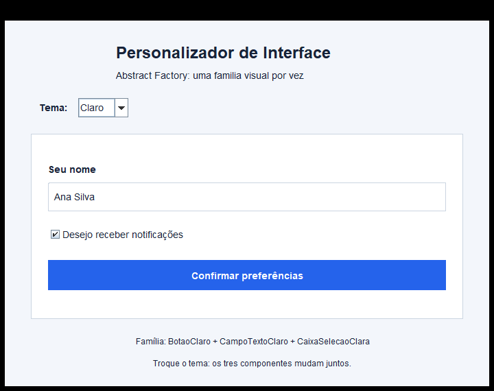
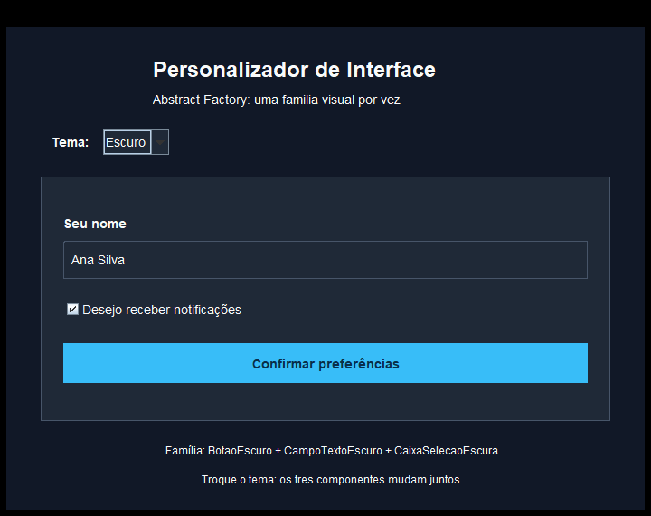
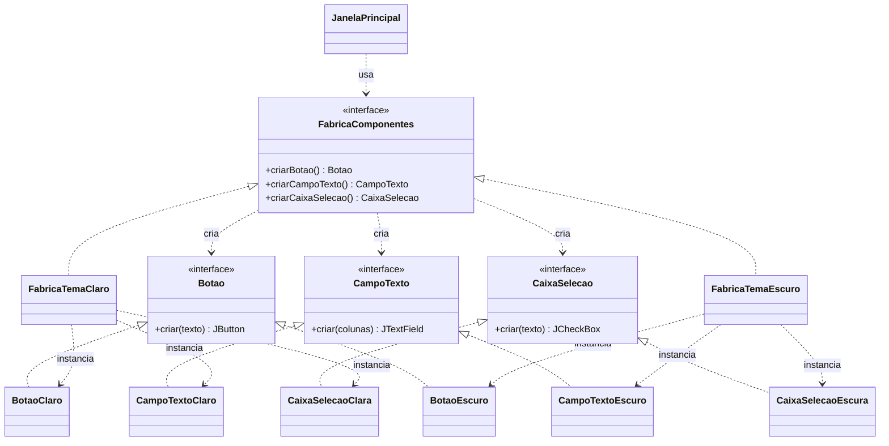

# APS-II — Abstract Factory: Personalizador de Interfaces

Projeto acadêmico de **Análise e Projeto de Sistemas II**, desenvolvido em **Java 17, Maven e Swing**, para demonstrar na prática o padrão de projeto criacional **Abstract Factory**.

A aplicação abre uma janela com um pequeno formulário. O usuário pode escolher entre **tema claro** e **tema escuro**, preencher seu nome, marcar uma opção e confirmar suas preferências. Ao trocar o tema, **três componentes são recriados em conjunto**: botão, campo de texto e caixa de seleção. O valor preenchido e a seleção são preservados.

> **Objetivo principal:** demonstrar o padrão Abstract Factory com famílias de objetos coerentes; não se trata de um sistema comercial completo ou de um exemplo de Factory Method.

## Visual da aplicação

| Tema Claro | Tema Escuro |
|---|---|
|  |  |

As imagens acima foram renderizadas pela janela nos testes de alternância. O diagnóstico e as evidências detalhadas estão em [Validação dos temas](docs/VALIDACAO_TEMAS.md).

## Tecnologias

- Java 17 ou superior;
- Maven 3.8+;
- Swing (biblioteca nativa do Java, sem necessidade de framework externo);
- JUnit 5.11.4 (testes automatizados);
- IntelliJ IDEA como ambiente de desenvolvimento.

O Maven compila com `release 17`. A validação local foi realizada no Windows 11 com Temurin 24.0.2 e Maven 3.10.0; isso não equivale a uma execução local em JDK 17.

## Como executar no IntelliJ IDEA

1. Clone o projeto: `git clone https://github.com/VicenzoBenelli/APS-II.git`.
2. Abra a pasta clonada no **IntelliJ IDEA** pelo `pom.xml` (projeto Maven).
3. Aguarde o Maven sincronizar as dependências e selecione **JDK 17 ou superior** em Project SDK e no executor do Maven.
4. Execute `src/main/java/br/edu/apsii/App.java` pelo botão **Run** do IntelliJ.
5. Na janela, escolha o tema, preencha seu nome e clique em **Confirmar preferências**.

Via terminal, na raiz do repositório:

```bash
mvn clean verify
java -jar target/abstract-factory-temas-1.0.0.jar
```

**Observação:** a interface Swing precisa de ambiente gráfico; a aplicação é destinada ao desktop (Windows, Linux ou macOS). Os seis testes das fábricas não precisam abrir uma janela; os dois testes de interface precisam de uma sessão gráfica e controlam o mouse durante a execução. Evite interagir com o computador enquanto esses testes estiverem rodando.

## Funcionalidades demonstradas

1. Seleção interativa de tema Claro ou Escuro;
2. Criação conjunta de botão, campo de texto e caixa de seleção da mesma família;
3. Preservação do texto e da seleção quando o tema muda;
4. Validação do nome obrigatório;
5. Confirmação das preferências por uma caixa de diálogo;
6. Rodapé que identifica **quais classes concretas foram utilizadas**, facilitando a explicação na apresentação.

## Onde o Abstract Factory aparece

O padrão **Abstract Factory** fornece uma interface para criar **famílias de objetos relacionados ou dependentes** sem que o código cliente precise conhecer suas classes concretas.

| Papel no padrão | Classes no projeto | Função |
|---|---|---|
| Abstract Factory | `FabricaComponentes` | Contrato com três métodos de criação de produtos |
| Concrete Factory | `FabricaTemaClaro` | Cria os três produtos da família clara |
| Concrete Factory | `FabricaTemaEscuro` | Cria os três produtos da família escura |
| Abstract Products | `Botao`, `CampoTexto`, `CaixaSelecao` | Interfaces dos produtos relacionados |
| Concrete Products (claro) | `BotaoClaro`, `CampoTextoClaro`, `CaixaSelecaoClara` | Produtos concretos da família clara |
| Concrete Products (escuro) | `BotaoEscuro`, `CampoTextoEscuro`, `CaixaSelecaoEscura` | Produtos concretos da família escura |
| Client | `JanelaPrincipal` | Utiliza apenas a fábrica e os produtos abstratos |
| Composição / seleção | `SeletorFabrica` | Escolhe a fábrica concreta em um único lugar |



### Um trecho importante do código

```java
public interface FabricaComponentes {
    Tema tema();
    Paleta paleta();
    Botao criarBotao();
    CampoTexto criarCampoTexto();
    CaixaSelecao criarCaixaSelecao();
}
```

Quando o usuário escolhe um tema, o seletor entrega uma implementação da fábrica. A tela usa os produtos abstratos sem usar `new BotaoClaro()` ou `new BotaoEscuro()`:

```java
Botao produtoBotao = fabrica.criarBotao();
CampoTexto produtoCampo = fabrica.criarCampoTexto();
CaixaSelecao produtoSelecao = fabrica.criarCaixaSelecao();
```

**Esse conjunto de três produtos relacionados é o diferencial do Abstract Factory neste projeto.**

O fluxo de execução é:

1. `App.main` agenda a abertura da janela na Event Dispatch Thread (EDT) com `SwingUtilities.invokeLater`.
2. O `JComboBox` de `JanelaPrincipal` informa o `Tema` escolhido; `SeletorFabrica.para(tema)` retorna a fábrica correspondente.
3. `JanelaPrincipal.aplicarTema` pede os três produtos à mesma `FabricaComponentes`. Os produtos criam os componentes Swing por seus métodos `criar(...)`.
4. A janela guarda o nome e a seleção, substitui apenas o formulário e restaura os valores. O seletor e o content pane permanecem instalados, evitando a remoção do popup durante seu evento.
5. A paleta e o rodapé são atualizados; o botão confirma os dados com o tema da fábrica usada.

`Paleta` e `Paletas` representam as cores; `EstilosComponentes` compartilha a montagem dos componentes Swing. Esses auxiliares não substituem as fábricas e os produtos do padrão.

## Por que Abstract Factory é o padrão mais adequado?

O sistema precisa manter uma **família de componentes visualmente compatíveis**, escolhida em tempo de execução. A fábrica abstrata garante um contrato de criação com todos os produtos esperados. As fábricas concretas fornecem versões coordenadas de cada componente (clara ou escura), evitando espalhar decisões sobre classes e estilos concretos pela tela.

Isso facilita manter a consistência visual, trocar uma família inteira e ampliar a aplicação com novas famílias. Por exemplo, para adicionar um tema de alto contraste, criaríamos três novos produtos e uma nova fábrica que implementasse `FabricaComponentes`; a lógica cliente da tela continuaria trabalhando com as mesmas interfaces. Seria necessário cadastrar o novo tema no seletor e na lista de temas.

### Outros padrões que poderiam ser usados

- **Simple Factory:** centraliza a seleção de uma classe concreta por parâmetro; `SeletorFabrica.para` exerce esse papel na escolha da fábrica. Usá-la isoladamente para criar botão, campo e caixa exigiria coordenar chamadas e temas, sem expressar por si só o contrato de uma família completa. Aqui ela auxilia o Abstract Factory, que define os três produtos relacionados.
- **Factory Method:** define um ponto de criação que subclasses do criador especializam, geralmente para um tipo de produto. Poderia ser combinado em vários métodos, mas seria necessário coordenar esses criadores para manter a família. O projeto usa composição com uma fábrica que oferece os três produtos, sem exigir subclasses de `JanelaPrincipal` para cada tema. Ter métodos chamados `criar` não basta, por si só, para caracterizar Factory Method.
- **Builder:** seria interessante para construir formulários complexos passo a passo, mas não resolve por si só a escolha entre famílias de componentes.
- **Strategy:** poderia selecionar uma estratégia de estilização, mas não substitui a criação coordenada de objetos de tipos diferentes.

## Aplicação dos princípios SOLID

O projeto utiliza os princípios SOLID para organizar as responsabilidades das classes, reduzir o acoplamento e facilitar a manutenção do código. O padrão **Abstract Factory** contribui principalmente para essa organização ao separar a criação dos componentes visuais de sua utilização na interface.

| Princípio | Aplicação no projeto |
|---|---|
| **S — Single Responsibility (Responsabilidade Única)** | Cada classe possui uma responsabilidade definida. `FabricaTemaClaro` e `FabricaTemaEscuro` são responsáveis por criar suas respectivas famílias de produtos. As classes `BotaoClaro`, `CampoTextoClaro`, `CaixaSelecaoClara` e suas equivalentes escuras implementam os componentes visuais de cada tema. `EstilosComponentes` centraliza a estilização compartilhada, `SeletorFabrica` seleciona a fábrica adequada e `JanelaPrincipal` gerencia a interface e as interações com o usuário. |
| **O — Open/Closed (Aberto/Fechado)** | O sistema permite adicionar novas famílias de componentes sem modificar a lógica principal de `JanelaPrincipal.aplicarTema`. Por exemplo, um tema azul poderia ter sua própria fábrica e seus produtos concretos, implementando as interfaces existentes. Entretanto, seria necessário registrar o novo tema em `Tema` e atualizar `SeletorFabrica`, demonstrando que a aplicação é extensível, mas não totalmente fechada para modificações. |
| **L — Liskov Substitution (Substituição de Liskov)** | As fábricas `FabricaTemaClaro` e `FabricaTemaEscuro` implementam a interface `FabricaComponentes` e podem ser utilizadas pela mesma lógica da aplicação. Ambas fornecem botão, campo de texto e caixa de seleção, respeitando os contratos estabelecidos. Assim, é possível substituir uma fábrica pela outra sem comprometer o funcionamento do formulário. |
| **I — Interface Segregation (Segregação de Interfaces)** | Os produtos possuem interfaces específicas: `Botao`, `CampoTexto` e `CaixaSelecao`. Cada interface define apenas o comportamento necessário ao seu componente, evitando que uma classe implemente métodos que não utiliza. Já `FabricaComponentes` reúne os métodos de criação porque sua finalidade é fornecer uma família completa de produtos relacionados. |
| **D — Dependency Inversion (Inversão de Dependência)** | `JanelaPrincipal.aplicarTema` utiliza as abstrações `FabricaComponentes`, `Botao`, `CampoTexto` e `CaixaSelecao`, em vez de depender diretamente de classes como `BotaoClaro` ou `CampoTextoEscuro`. As implementações concretas são escolhidas por `SeletorFabrica`. Isso permite trocar a família visual sem alterar a lógica que utiliza os componentes, reduzindo o acoplamento entre a interface e suas implementações. |

### Relação entre SOLID e Abstract Factory

O **Abstract Factory** não garante automaticamente a aplicação de todos os princípios SOLID. Entretanto, sua estrutura favorece alguns deles, especialmente:

- **Responsabilidade Única (SRP):** separa a criação dos produtos da lógica que os utiliza.
- **Aberto/Fechado (OCP):** facilita a inclusão de novas famílias de componentes.
- **Inversão de Dependência (DIP):** permite que a aplicação utilize interfaces em vez de depender diretamente das implementações concretas.

**Na prática:** quando o usuário alterna entre os temas Claro e Escuro, `JanelaPrincipal` utiliza a fábrica selecionada para criar uma nova família de componentes. A lógica do formulário permanece a mesma, enquanto os produtos concretos e suas características visuais são alterados.

Esse comportamento demonstra como o Abstract Factory pode contribuir para um sistema mais organizado, flexível e com menor acoplamento.

> O padrão não elimina todo uso de `new`: ele **centraliza a criação dos produtos concretos** nas fábricas. A seleção da fábrica concreta é feita em `SeletorFabrica`.

## Testes

Execute:

```bash
mvn clean verify
```

Resultado local em **17/11/2026**: **8 testes, 0 falhas, 0 erros e 0 ignorados**, com `BUILD SUCCESS`.

| Classe de teste | Quantidade | Cobertura |
| --- | --- | --- |
| `FabricaComponentesTest` | 6 | Produtos concretos de cada família, cores da paleta, diferença entre temas, tema nulo e número inválido de colunas. |
| `JanelaPrincipalTest` | 2 | Dez alternâncias com cliques reais via AWT Robot; dez alternâncias com verificação do formulário, cores, nome, checkbox marcado/desmarcado, listeners únicos, seleção repetida do mesmo tema, confirmação em ambos os temas e nome obrigatório. Captura de exceções não tratadas na EDT. |

Os relatórios são gerados em `target/surefire-reports/`; as imagens renderizadas durante o teste ficam em `target/evidencias/`. O comando `clean` remove resultados anteriores antes de executar novamente. As imagens versionadas e o relato da correção estão em [docs/VALIDACAO_TEMAS.md](docs/VALIDACAO_TEMAS.md).

Em ambiente **headless**, os dois testes gráficos são ignorados: um build aprovado nessa condição não comprova a interação visual. No Linux com Xvfb instalado, execute:

```bash
xvfb-run -a mvn -B clean verify
```

O workflow [ci.yml](.github/workflows/ci.yml) usa esse comando e configura Java 17 para pushes em `main` e pull requests. A validação local acima foi executada com JDK 24; o status de uma execução remota deve ser consultado no GitHub Actions.

## Organização do projeto

```text
APS-II/
├── pom.xml
├── README.md
├── .github/workflows/ci.yml
├── docs/ROTEIRO_APRESENTACAO.md
└── src/
    ├── main/java/br/edu/apsii/
    │   ├── App.java
    │   ├── fabrica/               (fabrica abstrata, fabricas concretas, temas)
    │   ├── produto/               (interfaces de produtos)
    │   │   ├── claro/             (tres produtos claros)
    │   │   └── escuro/            (tres produtos escuros)
    │   └── ui/                    (cliente Swing)
    └── test/java/br/edu/apsii/
        ├── fabrica/FabricaComponentesTest.java
        └── ui/JanelaPrincipalTest.java
```

## Apresentação

Consulte [`docs/ROTEIRO_APRESENTACAO.md`](docs/ROTEIRO_APRESENTACAO.md) para uma sequência curta de demonstração, explicação do padrão, princípios SOLID e perguntas prováveis da avaliação.

## Base de estudo

Material da disciplina **Análise e Projeto de Sistemas II — Aula 10**, Prof. Raul Andrade (UNIPÊ). A aula destaca encapsulamento da criação de objetos, dependência de abstrações, Simple Factory e Factory Method. O presente projeto estende esses fundamentos ao **Abstract Factory**, tema atribuído à equipe.
