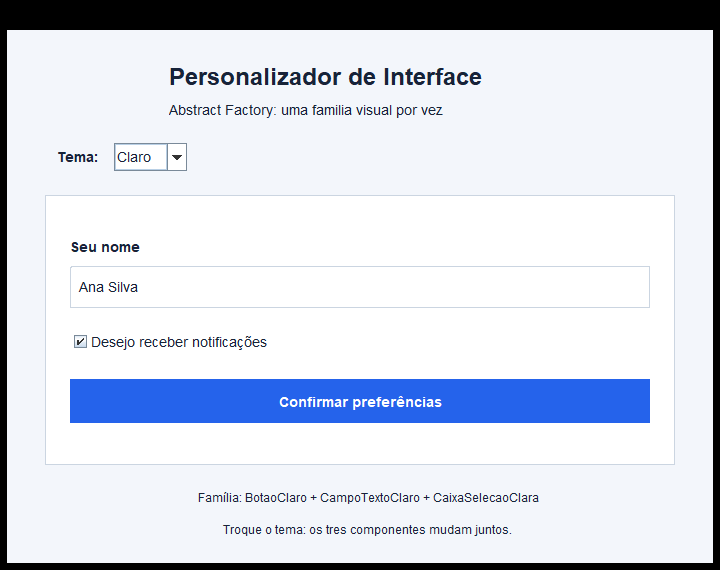
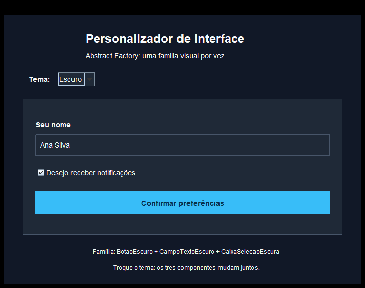

# Validação da alternância de temas

Validação local em 17/11/2026, Windows 11, Temurin 24.0.2 e Maven 3.10.0.
Compilação com `release 17`; execução em JDK 17 não foi realizada nesta máquina.

## Diagnóstico e correção

A aplicação já iniciava na EDT. A falha estava na substituição síncrona de todo o
content pane pelo listener do JComboBox enquanto o popup processava a seleção.
Uma reprodução mínima com JFrame, JComboBox e cliques reais via AWT Robot produziu
`IndexOutOfBoundsException: Index 1 out of bounds for length 1`, com a pilha
`Container.remove -> JLayeredPane.remove -> JRootPane.setContentPane`.
O popup leve ocupa o mesmo JLayeredPane; sua remoção durante a remoção do conteúdo
altera a lista de filhos enquanto o Swing ainda utiliza o índice anterior.
A seleção programática isolada não reproduziu essa exceção.

`JanelaPrincipal` mantém content pane, cabeçalho, seletor e rodapé instalados.
Somente o formulário com os três produtos é substituído. Texto e seleção são
restaurados; as cores da estrutura e os nomes da família são atualizados.
Selecionar novamente o tema atual não recria produtos; iniciar novamente não
acumula listeners. Não há captura de exceções para ocultar a falha.

`invokeLater` poderia adiar a substituição até depois do evento, mas manteria a
reconstrução desnecessária do seletor. A estrutura estável elimina essa operação.
App continua iniciando a janela na EDT; os listeners também executam nela.

Abstract Factory preservado: botão, campo e caixa são criados juntos através de
FabricaComponentes e dos produtos abstratos. Não foram adicionadas dependências.
As responsabilidades das fábricas e dos produtos permanecem separadas da tela;
os contratos pequenos e a dependência de abstrações permanecem inalterados.

## Verificações

`mvn clean verify`: 8 testes, zero falhas, erros ou testes ignorados.

- Seis testes de contratos, famílias, paletas e entradas inválidas.
- Teste gráfico de dez alternâncias com o popup, cores reais, nome preservado,
  checkbox marcado e desmarcado, listeners únicos, seleção do mesmo tema,
  confirmação em ambos os temas e validação do nome vazio.
- Teste com dez alternâncias por cliques reais via AWT Robot, nome e checkbox
  preservados e captura de exceções não tratadas na EDT.

Os testes gráficos abrem janelas reais e são ignorados somente se o ambiente for
headless. O workflow usa `xvfb-run` para disponibilizar uma tela virtual no Linux;
a execução remota desse workflow não faz parte da validação local.

Imagens renderizadas pela própria janela durante o teste, inspecionadas visualmente:

| Claro após retornar do Escuro | Escuro após sair do Claro |
| --- | --- |
|  |  |

## Publicação

A pasta recebida não possuía `.git`. Os metadados foram recuperados de um clone do
remoto, cujo main continha somente o README mínimo. A publicação inclui o código
Java e o pom existentes necessários para executar a correção, os testes, o
workflow, o gitignore e este relatório. O README local e os demais documentos
preexistentes foram preservados e ficam fora do commit.
